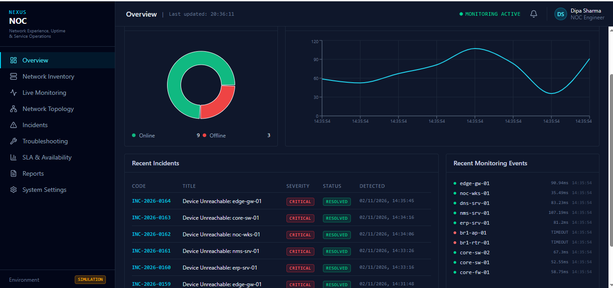
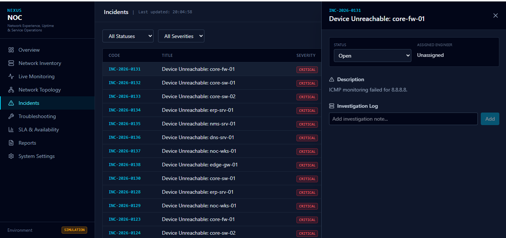
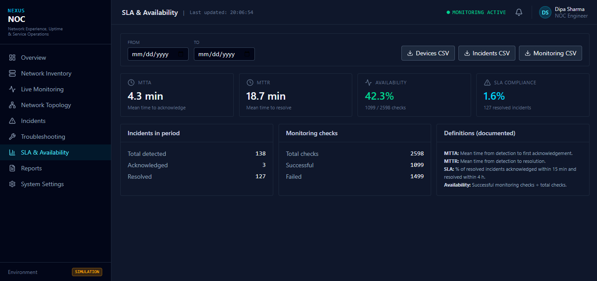

# NEXUS NOC — Network Operations Center Platform

A full-stack Network Operations Center (NOC) simulation platform designed to monitor network device availability, manage incident lifecycles, and track Service Level Agreement (SLA) performance through a centralized dashboard.


*(The Overview Dashboard: Real-time KPIs, ICMP monitoring, and active incidents)*

### Incident Management

*(Managing the lifecycle of a network outage: Open → Investigating → Resolved, with audit trails)*

### SLA & Reporting

*(Tracking Mean Time To Acknowledge, Mean Time To Resolve, and exporting operational reports)*

---

## Table of Contents

- [Project Overview](#project-overview)
- [Key Features](#key-features)
- [Technology Stack](#technology-stack)
- [System Architecture](#system-architecture)
- [Project Structure](#project-structure)
- [Installation and Setup](#installation-and-setup)
- [Running Tests](#running-tests)
- [Incident Management](#incident-management)
- [SLA Metrics](#sla-metrics)
- [Monitoring Workflow](#monitoring-workflow)
- [Limitations](#limitations)
- [Future Improvements](#future-improvements)
- [Project Purpose](#project-purpose)

---

## 1. Project Overview

**NEXUS NOC** is a full-stack portfolio project that simulates the core operations of an enterprise Network Operations Center.

The platform provides a centralized environment for monitoring network devices, detecting connectivity issues, generating incidents, tracking incident resolution, and analyzing network availability.

A background Python monitoring service performs ICMP connectivity checks against configured devices. Monitoring results are processed by the Flask backend and stored in the database, allowing the frontend dashboard to display network health and operational metrics.

The project demonstrates practical concepts related to:

- Network monitoring and troubleshooting
- Network Operations Center (NOC) workflows
- Python-based automation
- REST API development
- Incident management
- Database integration
- SLA performance monitoring
- Full-stack application development

## 2. Key Features

### Network Inventory Management
- Add, view, update, and delete network devices.
- Manage routers, switches, servers, and other network assets.
- Store device names, IP addresses, device types, and monitoring configurations.
- Validate IP addresses before saving device information.

### Real-Time Network Monitoring
- Background Python monitoring worker.
- ICMP-based device availability checks.
- Monitor device connectivity and response latency.
- Track successful and failed monitoring checks.
- Display device health status through the dashboard.

### Incident Management
- Automatically generate incidents when monitoring failures are detected.
- Track incident status and resolution progress.
- Maintain incident history and audit information.
- Support incident acknowledgement and investigation workflows.
- Monitor incident lifecycle transitions.

### SLA Analytics
- Mean Time to Acknowledge (MTTA).
- Mean Time to Resolve (MTTR).
- Network availability percentage.
- Monitoring performance statistics.
- Historical monitoring data analysis.

### Dashboard and Reporting
- Centralized network operations dashboard.
- Network health overview.
- Active incident monitoring.
- Device availability statistics.
- Monitoring history.
- CSV export functionality for supported records.

## 3. Technology Stack

| Component | Technologies |
|---|---|
| Frontend | React, TypeScript |
| Build Tool | Vite |
| Styling | Tailwind CSS |
| Charts | Recharts |
| Icons | Lucide Icons |
| Backend | Python, Flask |
| API | REST API |
| ORM | SQLAlchemy |
| Monitoring | Python Threading, ICMP |
| Database | SQLite |
| Testing | Pytest |
| Version Control | Git, GitHub |

## 4. System Architecture

NEXUS NOC follows a client-server architecture. The React frontend communicates with the Flask backend through REST APIs, while the backend manages database operations and monitoring results.

The independent background monitoring worker performs connectivity checks and updates device monitoring records.

### Architecture Diagram

```text
                  +-------------------------+
                  |      React Frontend     |
                  |                         |
                  |   Dashboard             |
                  |   Device Inventory      |
                  |   Incident Management   |
                  |   SLA Analytics         |
                  +------------+------------+
                               |
                               | REST API
                               |
                  +------------v------------+
                  |      Flask Backend      |
                  |                         |
                  |   API Routes            |
                  |   Business Logic        |
                  |   SQLAlchemy ORM        |
                  +------------+------------+
                               |
                    +----------+----------+
                    |                     |
                    v                     v
          +------------------+   +-------------------+
          | SQLite Database  |   | ICMP Monitoring   |
          |                  |   | Background Worker |
          | Devices          |   |                   |
          | Incidents        |   | Connectivity      |
          | Monitoring Logs  |   | Latency Checks    |
          +------------------+   +---------+---------+
                                           |
                                           v
                                  +------------------+
                                  | Network Devices  |
                                  |                  |
                                  | Routers          |
                                  | Switches         |
                                  | Servers          |
                                  +------------------+
```

### Architecture Components

**Frontend:** Provides the user interface for viewing device health, managing incidents, and analyzing network performance.

**Backend:** Handles API requests, application logic, device management, incident processing, and database communication.

**Monitoring Worker:** Runs periodic ICMP checks against configured network devices and records monitoring results.

**Database:** Stores device inventory, incident information, and monitoring history.

## 5. Project Structure

```text
nexus-noc/
│
├── backend/
│   ├── app.py
│   ├── seed.py
│   ├── requirements.txt
│   ├── tests/
│   └── ...
│
├── frontend/
│   ├── src/
│   ├── public/
│   ├── package.json
│   └── ...
│
├── docs/
│   └── screenshots/
│       ├── dashboard.png
│       ├── incidents.png
│       └── sla.png
│
├── .gitignore
└── README.md
```

*Note: The structure above is a simplified overview. Additional files and directories may exist in the project.*

## 6. Installation and Setup

Follow these instructions to run NEXUS NOC locally.

### Prerequisites

Ensure the following software is installed:

- Python 3.10 or higher
- Node.js 18 or higher
- npm
- Git

### Step 1: Clone the Repository

```bash
git clone https://github.com/D1pa9/noc-network-monitoring-system.git

cd noc-network-monitoring-system
```

### Step 2: Configure the Backend

Navigate to the backend directory:

```bash
cd backend
```

Create a Python virtual environment:

```bash
python -m venv venv
```

Activate the environment.

**Windows:**

```bash
venv\Scripts\activate
```

**Linux / macOS:**

```bash
source venv/bin/activate
```

Install the required dependencies:

```bash
pip install -r requirements.txt
```

Initialize the application with demo data:

```bash
python seed.py
```

Start the Flask backend:

```bash
python app.py
```

The backend should start on:

`http://localhost:5000`

### Step 3: Configure the Frontend

Open a new terminal and navigate to the frontend directory:

```bash
cd frontend
```

Install frontend dependencies:

```bash
npm install
```

Start the development server:

```bash
npm run dev
```

Open the application in your browser:

`http://localhost:5173`

### Step 4: Verify the Application

After starting both services, verify that:

- The frontend dashboard loads successfully.
- Network devices appear in the inventory.
- Monitoring results are displayed.
- Incident records are accessible.
- SLA metrics are available.

## 7. Running Tests

The backend test suite uses Pytest.

Navigate to the backend directory and activate the virtual environment.

Run:

```bash
pytest tests/ -v
```

This executes the backend tests and displays detailed results.

## 8. Incident Management

NEXUS NOC implements an incident lifecycle to represent common NOC operational workflows.

### Incident Statuses

```text
Open
  |
  v
Acknowledged
  |
  v
Investigating
  |
  v
Escalated
  |
  v
Resolved
  |
  v
Closed
```

Each incident can be tracked through its lifecycle to provide visibility into acknowledgement, investigation, escalation, and resolution.

The system maintains incident information to support operational tracking and performance analysis.

## 9. SLA Metrics

The platform includes key Service Level Agreement (SLA) metrics commonly used in network operations.

| Metric | Description |
|---|---|
| MTTA | Mean Time to Acknowledge an incident |
| MTTR | Mean Time to Resolve an incident |
| Availability | Percentage of successful monitoring checks |

### Mean Time to Acknowledge (MTTA)

Measures the average time between incident detection and the first acknowledgement.

**Formula:**

`MTTA = Total Acknowledgement Time / Number of Acknowledged Incidents`

### Mean Time to Resolve (MTTR)

Measures the average time between incident detection and incident resolution.

**Formula:**

`MTTR = Total Resolution Time / Number of Resolved Incidents`

### Network Availability

Measures the percentage of successful monitoring checks during a selected period.

**Formula:**

`Availability (%) = (Successful Checks / Total Checks) × 100`

These metrics help demonstrate how network availability and incident response performance can be evaluated in a NOC environment.

## 10. Monitoring Workflow

The monitoring process follows this general workflow:

1. Network devices are registered in the inventory.
2. The background monitoring worker retrieves configured devices.
3. ICMP connectivity checks are performed.
4. Response times and monitoring results are recorded.
5. Device health information is updated.
6. Monitoring failures can trigger incident generation.
7. Engineers can acknowledge and investigate incidents.
8. Resolution information contributes to operational reporting.

## 11. Limitations

NEXUS NOC is a demonstration and simulation platform. Some enterprise monitoring capabilities are not yet implemented.

### Simulated Network Environment

The monitoring environment uses a combination of local loopback and public DNS addresses, such as:

- `127.0.0.1`
- `8.8.8.8`
- `1.1.1.1`

This allows the application to demonstrate ICMP monitoring without requiring physical enterprise networking equipment.

### ICMP Limitations

A failed ICMP request does not necessarily indicate that a device is offline.

Firewalls, network policies, and ICMP filtering may prevent responses even when a device is operational.

Therefore, monitoring alerts should be investigated before concluding that a device has failed.

### SNMP Integration

The platform is currently focused on ICMP-based monitoring. Full SNMP polling for interface statistics, bandwidth utilization, and device uptime is planned for future development.

## 12. Future Improvements

Potential improvements include:

- **SNMPv3 Integration:** Collect interface traffic, device uptime, and network performance statistics.
- **Cisco Packet Tracer Integration:** Develop network lab scenarios for VLANs, routing, and switching.
- **Role-Based Access Control (RBAC):** Support multiple engineers with different access permissions.
- **Advanced Monitoring:** Introduce additional monitoring methods beyond ICMP.
- **Alert Notifications:** Integrate email or other notification channels.
- **Historical Analytics:** Add advanced network performance reports and trend analysis.
- **Docker Support:** Simplify deployment through containerization.
- **PostgreSQL Support:** Introduce a production-oriented relational database option.

## 13. Project Purpose

NEXUS NOC was developed as a practical portfolio project to demonstrate the integration of networking concepts, Python automation, backend development, database management, and frontend engineering.

It represents a simplified enterprise Network Operations Center environment and demonstrates an understanding of:

- Network availability monitoring
- ICMP troubleshooting
- Device inventory management
- Incident response workflows
- SLA performance measurement
- REST API architecture
- Full-stack application development

---

## Author

**Developed as a Network Operations Center (NOC) portfolio project.**

**Project:** NEXUS NOC — Network Operations Center Platform

**Repository:** `https://github.com/D1pa9/noc-network-monitoring-system`
---

*Built to demonstrate practical networking, monitoring automation, and full-stack development skills.*
